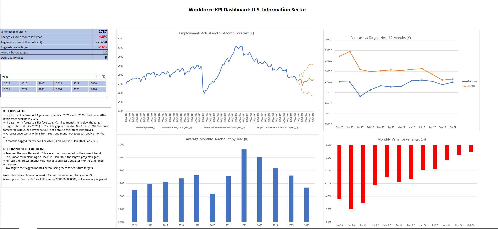

# Workforce KPI & Forecasting Tracker

An Excel workbook that cleans 142 months of U.S. Information-sector employment data, runs automated data-quality checks, forecasts the next 12 months, compares the forecast against a growth target, and reports the results on a one-page KPI dashboard.

## Business question

Will Information-sector employment reach a modest growth target over the next 12 months, and where are the largest gaps?

## Data

- **Source:** U.S. Bureau of Labor Statistics (Current Employment Statistics), via FRED, series [CEU5000000001](https://fred.stlouisfed.org/series/CEU5000000001)
- **Coverage:** January 2015 to October 2026, monthly (142 rows)
- **Units:** thousands of employees, **not seasonally adjusted**. The raw series keeps the yearly pattern (for example, the January drop), which the forecast needs to learn.
- Raw file: `data/information_employment_raw.csv`

## Workbook structure

| Sheet | What it does |
|---|---|
| **Dashboard** | Six KPIs, year slicer, four charts, key insights and recommended actions |
| **Forecast** | 12-month forecast with 95% confidence bounds, accuracy statistics, target and variance |
| **Data** | Cleaned table (`tblData`), data-quality check columns, outlier summary, pivot table |

## Method

1. **Load and clean (Power Query):** renamed columns, set data types, removed blank rows, sorted by date. The steps are recorded, so the cleaning is repeatable on new data.
2. **Data-quality checks:** a formula column for each check:
   - month gaps (`EDATE`)
   - duplicate months (`COUNTIF`)
   - missing values
   - outliers: month-over-month changes more than 3 standard deviations from the average
3. **Second-pass outlier check:** the April 2020 COVID drop inflated the standard deviation and hid smaller anomalies (masking). Recalculating the threshold without it (`FILTER`) flagged two more months for review.
4. **Forecast (Excel Forecast Sheet / `FORECAST.ETS`):** exponential triple smoothing with seasonality set to 12. On automatic detection the forecast came out almost flat and missed the January pattern, so seasonality was set manually.
5. **Target and variance:**
   - Target = same month last year + 1%. Comparing year over year keeps the seasonal pattern from distorting the comparison.
   - Variance = Forecast − Target, in thousands and in %.
6. **Dashboard:**
   - KPI formulas (`INDEX`/`ROWS`, `AVERAGE`, `COUNTIF`)
   - pivot table and pivot chart with a year slicer
   - forecast, forecast-vs-target and monthly variance charts
   - written insights and actions

## Key results

| Metric | Value |
|---|---|
| Latest headcount (Oct 2026) | 2,737K |
| Change vs same month last year | −4.0% |
| Average forecast, next 12 months | 2,737K (flat) |
| Average variance vs target | −2.6% |
| Months below target | 12 of 12 |
| Data-quality flags | 3 (0 gaps, 0 duplicates, 0 missing) |

- **Data quality:** April 2020 was flagged as an outlier (COVID). January 2023 and January 2026 were flagged for review in the second pass.
- **Forecast fit:** MASE 0.73, which beats a naive "next month = this month" forecast. MAE is 15.65K, about 1% average error. These figures measure fit to the history, not guaranteed future accuracy.
- **Uncertainty:** the 95% range widens from ±61K one month out to ±180K twelve months out.
- **Largest shortfall:** December 2026 (−5.0%). The gap narrows to −0.6% by October 2027, but only because the targets fall with 2026's lower actuals. The forecast itself does not improve.

## Assumptions and limitations

- The 1% growth target is an illustrative assumption, not a real company goal.
- April 2020 is kept in the history because it is real data. It widens the confidence range.
- This is sector-level data, not company or department headcount.

## How to refresh

1. Download the latest CSV from FRED and replace the file in `data/`.
2. In Excel: **Data > Refresh All** (reloads the Power Query table and the pivot table).
3. Recreate the forecast with **Data > Forecast Sheet**, because Excel writes the forecast ranges as fixed cell references. Then update the Dashboard ranges that point to the forecast rows.

## Tools

Excel: Power Query, Excel Tables and structured references, `FORECAST.ETS`, PivotTables, PivotCharts, slicers, conditional formatting.
